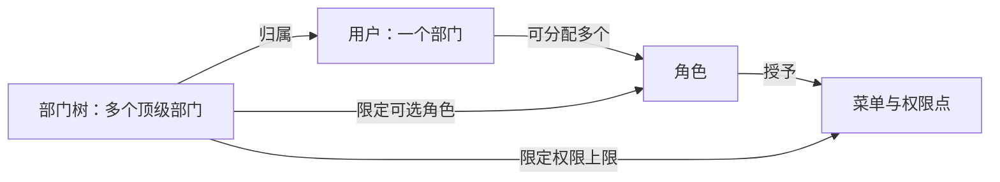

# 用户、部门、角色、权限架构对照（2026-09-29）

## 已确认的业务边界

- 当前只有一家公司。部门树可以有多个**顶级部门**；`parent_id=0` 表示“无上级部门”，不表示“另一家公司”。`总测试 → 测试1` 是一条父子关系。
- 一个普通用户归属一个部门，可分配多个角色；部门限制可选角色和菜单/按钮权限上限。超级管理员只有一个，是全局身份，不列入部门角色候选。
- 图片、订单等业务数据继续按用户隔离。图片查重在全站范围进行；其他用户的候选图片详情不能通过当前用户接口取得。未来若引入多家公司，再单独定义公司归属和公司级边界。

有效菜单/按钮权限 = 用户角色授予的权限 ∩ 所属部门权限上限。角色的部门**数据范围**是另一条规则，不等于“部门可选角色”。部门父子关系也不自动把上级角色或菜单授权给下级。

## 成熟方案的一手源码对照

| 方案 | 已核对的实际设计 | 对本项目的判断 |
| --- | --- | --- |
| RuoYi-Vue-Plus | [部门实体](https://github.com/dromara/RuoYi-Vue-Plus/blob/9227f626a3a37e1546d6c291ed398183e94df92b/ruoyi-modules/ruoyi-system/src/main/java/org/dromara/system/domain/SysDept.java)保存 `parentId`、`ancestors`、排序；[服务](https://github.com/dromara/RuoYi-Vue-Plus/blob/9227f626a3a37e1546d6c291ed398183e94df92b/ruoyi-modules/ruoyi-system/src/main/java/org/dromara/system/service/impl/SysDeptServiceImpl.java)返回平铺部门列表；[配套前端](https://github.com/CrazyLionCat/plus-ui/blob/045fc006725c014455def9fed19f93c781633d26/src/views/system/dept/index.vue)组树后渲染树表。用户有单个 `deptId`，独立[用户角色关联](https://github.com/dromara/RuoYi-Vue-Plus/blob/9227f626a3a37e1546d6c291ed398183e94df92b/ruoyi-modules/ruoyi-system/src/main/java/org/dromara/system/domain/SysUserRole.java)允许多角色；[角色部门关联](https://github.com/dromara/RuoYi-Vue-Plus/blob/9227f626a3a37e1546d6c291ed398183e94df92b/ruoyi-modules/ruoyi-system/src/main/java/org/dromara/system/domain/SysRoleDept.java)用于数据范围。 | 本项目沿用同源模型。树表组装方式值得复用；无需换框架或重建用户、部门、角色表。 |
| 芋道 yudao-cloud | [用户](https://github.com/YunaiV/yudao-cloud/blob/77dd74e65cbb913d7cd84e9d9e6cd3a9f0daff56/yudao-module-system/yudao-module-system-server/src/main/java/cn/iocoder/yudao/module/system/dal/dataobject/user/AdminUserDO.java)仍有单个 `deptId`，多角色和角色菜单分别用[用户角色](https://github.com/YunaiV/yudao-cloud/blob/77dd74e65cbb913d7cd84e9d9e6cd3a9f0daff56/yudao-module-system/yudao-module-system-server/src/main/java/cn/iocoder/yudao/module/system/dal/dataobject/permission/UserRoleDO.java)、[角色菜单](https://github.com/YunaiV/yudao-cloud/blob/77dd74e65cbb913d7cd84e9d9e6cd3a9f0daff56/yudao-module-system/yudao-module-system-server/src/main/java/cn/iocoder/yudao/module/system/dal/dataobject/permission/RoleMenuDO.java)表示；[部门](https://github.com/YunaiV/yudao-cloud/blob/77dd74e65cbb913d7cd84e9d9e6cd3a9f0daff56/yudao-module-system/yudao-module-system-server/src/main/java/cn/iocoder/yudao/module/system/dal/dataobject/dept/DeptDO.java)有 `parentId`，租户编号独立放在[TenantBaseDO](https://github.com/YunaiV/yudao-cloud/blob/77dd74e65cbb913d7cd84e9d9e6cd3a9f0daff56/yudao-framework/yudao-spring-boot-starter-biz-tenant/src/main/java/cn/iocoder/yudao/framework/tenant/core/db/TenantBaseDO.java)；[部门数据权限规则](https://github.com/YunaiV/yudao-cloud/blob/77dd74e65cbb913d7cd84e9d9e6cd3a9f0daff56/yudao-framework/yudao-spring-boot-starter-biz-data-permission/src/main/java/cn/iocoder/yudao/framework/datapermission/core/rule/dept/DeptDataPermissionRule.java)是独立维度。 | 支持“部门根节点不等于公司”的判断。当前复制其多租户模块会显著增加复杂度；出现第二家公司时再评估。 |
| Casbin | [RBAC with domains](https://v3.casbin.org/docs/rbac-with-domains)把用户角色关系放进指定 domain，适合一个用户在不同租户持有不同角色。 | 当前用户只归属一个部门、单一公司，现有 Sa-Token 和关系表足够；引入第二套授权引擎会造成两份权限真相。 |
| Qdrant | [官方多租户文档](https://qdrant.tech/documentation/tutorials/multiple-partitions/)介绍在共享 collection 中用 payload 过滤租户，独立 collection 有资源开销。 | 当前查重全站共享，不应加公司过滤。未来若公司间候选可见性变化，需同时审查数据库、向量检索、返回内容和导出。 |

[Ant Design Table 官方文档](https://ant.design/components/table/)说明有 `children` 的行按树表展示，`expandedRowKeys` 控制展开状态；“搜索子部门时保留祖先”是本项目的交互规则。

## 本项目现状与改动

| 关系/入口 | 当前代码 | 结论 |
| --- | --- | --- |
| 部门树 | [`sys_dept.parent_id`、`ancestors`](../../server/script/sql/wuzh_vue.sql)，[`/list` 平铺数据](../../server/wuzh-modules/wuzh-system/src/main/java/org/dromara/system/controller/system/SysDeptController.java)，[前端组树](../../web/src/pages/system/dept/tree.ts) | 数据关系原本正确，旧页面直接显示平铺行。现已组树、支持多根、展开折叠和保留搜索命中的祖先；线上只读核对 `测试1.parent_id=总测试.dept_id`。 |
| 增加与编辑上级部门 | [部门表单](../../web/src/pages/system/dept/index.tsx)、[部门服务](../../server/wuzh-modules/wuzh-system/src/main/java/org/dromara/system/service/impl/SysDeptServiceImpl.java) | 已将“已有上级、新建顶级上级并加子部门、当前作为顶级部门”分开。服务端事务内创建两个部门；编辑顶级部门显示“无上级”；全局新增不再预选任意一个顶级部门。 |
| 用户与角色 | [`sys_user.dept_id`、`sys_user_role`、`sys_dept_role`](../../server/script/sql/wuzh_vue.sql)，[部门角色校验](../../server/wuzh-modules/wuzh-system/src/main/java/org/dromara/system/service/SysDeptRoleService.java) | 一人单部门、多角色，部门角色是候选上限，不自动授予部门全员；服务端拒绝把超级管理员角色放进部门或分配给普通用户。保留结构。 |
| 菜单与权限点 | [`sys_role_menu`、`sys_dept_menu`](../../server/script/sql/wuzh_vue.sql)，[取用户权限](../../server/wuzh-modules/wuzh-system/src/main/java/org/dromara/system/service/impl/SysMenuServiceImpl.java)，[部门权限维护](../../server/wuzh-modules/wuzh-system/src/main/java/org/dromara/system/service/SysDeptPermissionService.java) | 用户角色给权限，部门设上限；不能仅凭前端按钮可见性授权。保留服务端校验。 |
| 部门数据范围 | [`sys_role_dept`](../../server/script/sql/wuzh_vue.sql)、[数据权限处理器](../../server/wuzh-common/wuzh-common-mybatis/src/main/java/org/dromara/common/mybatis/handler/PlusDataPermissionHandler.java) | 此表描述角色可查看哪些部门的数据，与 `sys_dept_role` 方向相反。角色 `ALL` 只作用于启用该拦截器的查询，不能代替业务数据的按用户隔离。 |
| 业务数据隔离 | [图片服务](../../server/wuzh-modules/wuzh-image/src/main/java/org/dromara/image/service/ImageService.java)按创建用户过滤批次/图库和候选详情；[订单服务](../../server/wuzh-modules/wuzh-order/src/main/java/org/dromara/order/service/OrderDetailService.java)按 `owner_id` 过滤；[套图服务](../../server/wuzh-modules/wuzh-order/src/main/java/org/dromara/order/store/service/StoreWorkflowService.java)校验 `owner_id` | 当前按用户隔离。每个新列表、详情、下载、导出入口都应复用服务端所有权校验；尚未针对未来多公司场景验证。 |

## 决策与验收

1. **本轮实施**：沿现有 RuoYi 系模型补齐树表及根节点新增/编辑；文案统一为“顶级部门”；全局新增不暗选第一棵树。验收：`总测试 → 测试1` 可展开，搜索 `测试1` 保留 `总测试`，多个顶级部门并列，顶级部门编辑显示无上级。
2. **保留授权链**：服务端继续校验部门可选角色、用户角色、部门权限上限和业务记录所有权。超级管理员不进部门角色选项。验收：普通用户不能靠伪造部门、角色、菜单或业务 ID 访问他人数据。
3. **以后再做**：出现第二家公司且明确跨公司账号和数据规则时，引入独立公司维度；不把顶级部门 ID 当公司 ID。若仍“全站查重、公司间候选不可见”，需逐条验证 SQL、Qdrant、返回 DTO 和下载接口。

本地复验：前后端容器重新构建且健康；10 个相关后端测试和 2 个前端树测试通过，`pnpm lint` 通过。真实页面验证了展开/折叠、搜索子部门保留祖先、新增上级不默认选中、编辑顶级部门显示“无上级”、部门角色候选不含超级管理员，以及“设置部门权限”能够读取。原本本地数据库缺少部门管理菜单五条记录，已仅从既有迁移 SQL 补齐这五条菜单数据；没有改动其他本地业务记录。

先前树表改动已推送 GitHub；本轮文案和默认选择改动尚未推送。生产未部署，线上仍是旧页面与接口。
