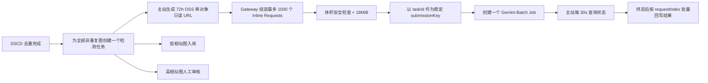

# Gemini Batch 生产稳定性审查

> 状态：设计审查稿，尚未实施、尚未发布。
> 日期：2026-09-15

## 结论

当前“主站分块上传图片字节，Gateway 把 Base64 写入一个 JSONL，再提交文件式 Batch”的初稿不能上线。

推荐改为：**OSS 72 小时单对象只读签名 URL + Gemini Inline Batch**。一个用户上传批次仍只创建一个 Gemini Batch 作业，但作业内含每张图片一个 `GenerateContentRequest`。图片本身不经过主站内存、Gateway 内存或 Gateway 磁盘，Gemini 处理时直接从有效期内的 OSS URL 读取。

## 为什么现有初稿不能上线

1. `claimed` 保留整批 `byte[]`，1000 张、20MiB/张时最坏需要约 20GiB Java 堆。
2. Base64 约增大 1/3，1000 张最坏会形成约 26.7GiB JSONL，远超 Gemini Batch 单个输入文件 2GB 限制。
3. Java SDK 1.68.0 的 Gemini Developer API 文件源只能设置 `fileName`；当前初稿同时设置 `format("jsonl")`，SDK 会在创建作业前直接抛出 `IllegalArgumentException`。
4. `InlinedRequest.toJson()` 是 SDK 内部类型的原始 JSON，它使用 `config`。Gemini JSONL 需要完整 REST `GenerateContentRequest`；SDK 正常调用时会把 `config` 转换为 `generationConfig`，并把 `tools` 提到请求顶层。当前手写 JSONL 绕过了这一转换，请求结构不正确。
5. 中间分块异常不在统一异常处理内，可留下 `PROCESSING + provider_job_id IS NULL` 和 Gateway 临时文件。
6. Gateway 分块会话只在 JVM 内存，重启丢失；临时文件无 TTL。
7. Batch 创建不幂等。如果 Google 已创建作业但 HTTP 响应丢失，盲目重提会生成第二个计费作业。

## 方案对比

| 方案 | 优点 | 主要问题 | 结论 |
| --- | --- | --- | --- |
| Base64 + 单 JSONL | 理论上一个作业 | 主站 OOM、Gateway 磁盘、2GB 上限、分块恢复复杂 | 否决 |
| 逐图上传 Gemini Files + JSONL | 可引用大文件 | 1000 张需要约 1000 次文件上传，失败点多；文件 48 小时过期且项目总容量 20GB | 不选 |
| OSS 签名 URL + Inline Batch | 不传图片字节、无 JSONL/临时盘、一次创建一个作业 | URL 需要覆盖最长 48 小时作业生命周期 | **推荐** |

## 推荐生产流程

检测与入库/人工审核并行。人工拒绝的图片即使后续收到 AI 结果，也只保留审计数据，不改变图库状态。

## 稳定性约束

1. **一批一个任务/一个作业**：SSCD 结束时一次性为全部非重复图建立检测任务，不在“自动入库”和“人工审核通过”后分别建任务。
2. **不传图片字节**：主站只发送 URL、MIME、图片 ID 和序号；Gateway 不下载图片。
3. **URL 有效期 72 小时**：Gemini Batch 最长在 pending/running 48 小时后过期，72 小时覆盖队列、时钟偏差和抓取窗口。URL 仅允许读单个对象，不记录到日志。
4. **18MiB 本地门槛**：官方 Inline Batch 总请求上限为 20MB，Gateway 在调用 SDK 前对实际序列化内容做 18MiB 安全门槛。1000 个 URL + 当前约 3KB Prompt + Schema 预计明显低于此值，但仍必须用测试锁定。
5. **不自动重提**：SDK HTTP attempts 保持 1。网络结果未知时只按 `submissionKey/displayName` 查询已存在作业，这是状态恢复，不是第二次模型调用。
6. **稳定提交标识**：使用 `image-risk-task-{taskId}` 作为唯一 displayName。Gateway 创建前先查同名作业；主站未收到 jobId 时进入“提交结果未知”，查到后绑定，不盲目再创建。
7. **一次 SQL 绑定**：请求序号在提交前事务性写入；jobId 返回后按 `taskId + submissionKey` 一次批量绑定，避免 1000 次更新的半成功。
8. **提交与轮询隔离**：使用两个独立单线程调度器，避免任何提交阻塞已有作业轮询。
9. **明确终态**：`SUCCEEDED` 解析每个结果；`FAILED/CANCELLED/EXPIRED` 全部置失败；单项错误只影响该图。技术失败不得写成 LOW。
10. **轮询异常分类**：401/403/404 等确定性错误结束任务；429/5xx/网络错误仅继续查询状态，不重提模型任务。

## Google Search 边界

- 每个 Batch 子请求都配置 `googleSearch`。
- Google 官方机制是“模型决定是否执行搜索”，Prompt 不能把工具强制成每图必搜。
- 系统仅保存当次响应的 `groundingMetadata.webSearchQueries`；没有该元数据就显示“未使用”。
- 不为了验证搜索再次调用 Gemini，避免重复计费。

## 可验收的上线门槛

1. 单元测试覆盖：1000 条 URL 仍只创建 1 个 Batch Job；请求体低于 18MiB；SDK 生成的每个请求包含顶层 `tools` 和 `generationConfig`。
2. 故障测试覆盖：创建响应丢失、主站重启、Gateway 重启、轮询 429/5xx、作业 EXPIRED、单项失败。
3. 使用生产付费项目做 5 张小批和 101 张 Batch 真实冒烟，核对：作业数、返回数、图片 ID 映射、风险字段、Search 元数据和失败原因。
4. 先检查 AI Studio 的当前付费层级和 `gemini-3.8-flash` Batch enqueued-token 配额。

## 不能承诺的事

- 不能承诺外部 Gemini 永不返回错误；可承诺的是不卡死、不把技术失败写成 LOW、不自动重复计费，并把失败原因交给页面手动重试。
- 官方 Batch 的目标完成时间是 24 小时，pending/running 超过 48 小时会过期，因此不能承诺 1000 张在 20 分钟内完成。若 20 分钟是硬 SLA，应选 Standard/中转站并承担更高成本，不应选 Batch。

## 主要依据

- [Gemini Batch API](https://ai.google.dev/gemini-api/docs/batch-api)
- [Gemini 文件输入方法（GenerateContent）](https://ai.google.dev/gemini-api/docs/generate-content/file-input-methods)
- [Gemini 限流与 Batch 配额](https://ai.google.dev/gemini-api/docs/rate-limits)
- [Grounding with Google Search](https://ai.google.dev/gemini-api/docs/google-search)
- [Structured Outputs](https://ai.google.dev/gemini-api/docs/structured-output)
- [googleapis/java-genai v1.68.0 Batches.java](https://github.com/googleapis/java-genai/blob/v1.68.0/src/main/java/com/google/genai/Batches.java)
