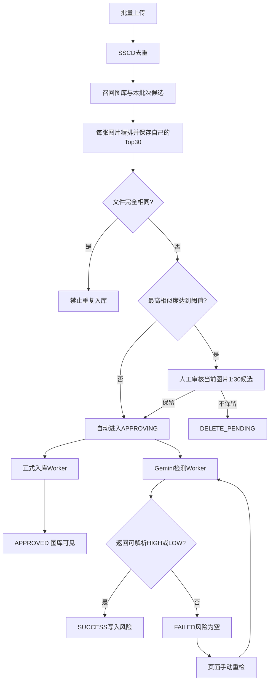

# Gemini 图片侵权风险检测设计

## 1. 目标与边界

在现有图片去重流程中加入 Gemini 图片侵权风险检测。SSCD 最高相似度低于批次阈值的图片不再等待人工确认，自动进入正式入库流程并创建异步侵权检测任务；达到阈值的图片才进入人工审核，每张待审图片展示它自己的最相似 30 张候选。Gemini 结果不作为正式入库门禁；任何网络、配额、超时或解析失败都记录为“检测失败”，风险等级保持为空，绝不伪装成低风险。

本次实现包含主站任务管理、独立 AI Gateway、Gemini 调用、数据库状态、页面手动重检、风险结果展示、最小配置示例和本地自动化测试。不直接操作阿里云 ECS、1Panel、DNS、证书、安全组或真实生产密钥，也不建设 IP/TRO 知识库、搜索 Grounding、AI 结果缓存、Embedding、Redis 队列、AI 调用日志表、在线配置表、任务配置快照、Kafka、Nacos 或 Kubernetes。

## 2. 已选方案与取舍

采用“同一仓库、两个独立 Spring Boot 应用”的生产形态：

- 主站继续运行现有 `wuzh-admin`，负责登录、审核、任务状态、页面手动重检、正式入库和前端 API。
- 新增轻量 AI Gateway 应用，负责静态服务令牌校验、单次 Gemini 调用和标准化响应，不连接业务数据库。
- 本地 Compose 可同时启动两个应用；生产时将 Gateway 单独部署到新加坡 ECS。
- 主站只使用 MySQL 作为任务唯一事实来源和工作队列，Redis 完全不参与侵权检测。现有图片后台任务已经采用数据库持久状态与定时 Worker，V1 直接复用该模式。

未采用的方案：

1. 主站直接调用 Gemini：代码最少，但 Gemini Key 会进入中国主站，违反文档的密钥与区域隔离要求。
2. HMAC 请求签名：安全性更强，但需要 timestamp、nonce、图片摘要、签名计算和防重放存储。V1 改为 HTTPS、安全组仅允许主 ECS EIP、一个静态服务令牌；若未来 Gateway 对多调用方开放，再升级为 HMAC 或 mTLS。
3. 主站或 Gateway 自动重试：会带来不可控的额度消耗和重复计费。最终两端都不自动重试，每个 item 只调用一次 Gemini，失败后只能由页面按钮创建新的检测 item。
4. 第一版直接强制 JSON Schema：解析简单，但可能改变客户已经认可的网页端行为。第一版固定使用客户原始文本 Prompt 并保存原始响应；经样本对照确有需要时再增加结构化输出。

## 整体流程图

关键边界：低于阈值自动入库，达到阈值才人工审核；完全相同的文件禁止重复入库。入库 Worker 与检测 Worker 并行执行，互不等待。Gemini 失败不会删除、回退或阻止图片。Gateway 不重试，页面批量重检会创建新记录并保留历史失败 item。

## 3. 业务状态与数据模型

### 3.1 状态

侵权检测 item 状态：

- `PENDING`：等待 AI 检测。
- `PROCESSING`：Worker 已抢占并正在调用 Gateway。
- `SUCCESS`：成功解析为 `HIGH` 或 `LOW`。
- `FAILED`：单次调用失败，页面显示“检测失败”。

不存在自动重试或退避状态。失败 item 保持 `FAILED`，页面手动重检时创建新 item 并保留原失败记录。

图片入库状态与侵权检测状态完全分离。`APPROVING` 表示低于阈值自动入库或人工确认后正在执行 OSS 提升和 Qdrant 写入，`APPROVED` 表示正式入库完成；无论侵权检测最终是 `SUCCESS` 还是 `FAILED`，都不回退或阻止图片入库。

批次只要仍有高相似图片就保持 `WAIT_REVIEW`，但其中低相似图片的正式入库不被阻塞。全部待审图片提交决定后进入 `CONFIRMING`。检测 task 不保存状态；页面根据 item 状态实时派生“等待中、处理中、已完成、部分失败、全部失败”。

### 3.2 表

新增最小两表：

- `infringement_scan_task`：只保存任务 ID、任务编号、任务类型、来源批次、创建人和创建时间。不保存状态、配置快照或任何实时计数。
- `infringement_scan_item`：每张图片的处理状态、风险结果、原始响应、调用次数和错误信息。

任务列表和详情页需要的总数、高风险、低风险、处理中和失败数，通过对 `infringement_scan_item` 的分组查询实时计算，避免每处理一张图片都更新 task 多个计数字段并处理计数一致性。

第一版不新增运行时配置表、Prompt 表或任务配置快照。主站只配置 Gateway URL、服务令牌、请求超时和 Worker 并发；不配置重试次数或退避时间。Gateway 只配置 Google Key、服务令牌和模型；客户 Prompt 放在 Gateway 的一个资源文本文件中。配置变更通过重新部署 Gateway 生效，并应在没有运行中任务时进行。

`img_asset` 新增 `infringement_scan_item_id` 指向当前检测记录，新增 `approved_at` 记录真实正式入库时间，并使用 `similar_matches_json` 保存该图片经精排后的最多 30 个候选 ID、分数、排名顺序和来源。Top30 是每张高相似图片自己的快照，不是批次共享结果；不新增相似关系表，也不在打开页面时重新查询 Qdrant。

## 4. 主站流程

### 4.1 自动分流与人工确认

去重 Worker 对每张有效图片完成精排后：

1. 每张图片只计算原图、中心裁剪、90°、180°、270° 共 5 个视图。
2. 合并正式图库与当前批次中已经处理的候选，按最终精排分数排序，给达到阈值的图片保存各自的 Top30 快照。
3. 低于阈值的图片直接写为 `APPROVING`；达到阈值的图片写为 `WAIT_REVIEW`；完全相同文件继续禁止入库。
4. 批次去重完成时，在同一事务中为全部自动入库图片创建 `PENDING` 检测 item，并把批次切换到 `CONFIRMING` 或 `WAIT_REVIEW`。

`ImageService.confirm` 只处理仍处于 `WAIT_REVIEW` 的高相似图片：

1. 保留批次归属、失败图片、完全相同文件和相似度上限校验。
2. 未选择的待审图片写为 `DELETE_PENDING`。
3. 选择的待审图片写为 `APPROVING`；已经自动进入 `APPROVING` 或 `APPROVED` 的图片保持不变。
4. 同时创建一个初次检测 task 和对应 `PENDING` items，并把图片的 `infringement_scan_item_id` 指向新 item。
5. 批次继续写为现有 `CONFIRMING`，HTTP 立即返回。

重复提交继续由现有批次条件更新阻止。入库和侵权任务创建处于同一个数据库事务，保证不会出现已经确认但没有检测任务的图片。

### 4.2 Worker

定时 Worker 每次领取少量 `PENDING` item，通过条件更新将状态原子地改为 `PROCESSING`，不等待图片从 `APPROVING` 变成 `APPROVED`。并发由配置控制，初始值为 8。正式入库失败与侵权检测失败分别处理，互不修改对方状态。

单项处理流程：

1. 从 `img_asset.storage_key` 直接读取当前图片字节，不额外缩放、转码或生成第二份图片。若恰好遇到入库 Worker 完成 OSS Copy 并切换 object key，读取失败后只重新查询一次 `storage_key` 并重试本地读取；之后仍失败则直接记为 `FAILED`，不再调用 Gemini。
2. 生成 requestId，通过 HTTPS multipart 请求携带图片和静态服务令牌调用 Gateway。
3. Gateway 每个请求只调用一次 Gemini，不在 Gateway 内重试。
4. 严格解析 `高风险` 或 `低风险`；任何缺字段、歧义或超长内容都作为技术失败。
5. 成功时只更新 item 结果，不修改图片的正式入库状态。
6. 任何网络、配额、超时、解析或读取异常都立即把 item 写为 `FAILED`，风险等级保持为空，不自动重试。

定时恢复任务把超过 10 分钟的 `PROCESSING` item 直接改为 `FAILED`。状态更新必须带旧状态条件，确保多实例不会同时处理同一 item。

### 4.3 入库与检测一致性

人工确认事务同时创建入库状态和检测 item，提交后两个 Worker 并行执行。正式入库继续复用 `ImageAdmissionWorker` 的 OSS Copy、Qdrant upsert 和数据库条件更新，不等待 Gemini；检测 Worker 可以读取 review 对象，也可以在 object key 已切换后读取 library 对象。入库 Worker 先完成 Copy、再更新 `storage_key`、最后异步删除旧对象，因此检测读取失败时重新查询一次当前 key 即可覆盖切换窗口，不需要新增锁、临时表或对象引用计数。检测失败只影响侵权状态，不影响图片的 `APPROVED` 状态、OSS 对象或 Qdrant 向量。

### 4.4 批量重新检测全部失败图片

页面按钮作用于当前登录用户所有历史任务中“当前 item 状态为 `FAILED`”的正式图片，不局限于当前任务。点击后，服务端在事务内重新查询符合权限的失败图片，创建一个新的批量重检 task 和 items，并把这些图片的 `infringement_scan_item_id` 指向对应的新 item。

历史失败 item 不修改、不删除。连续点击通过重复提交保护和条件更新避免同一张图片同时进入多个重检任务。若当前用户没有失败图片，接口返回成功且创建数量为 0，不产生空任务或 Gemini 调用。

## 5. AI Gateway

Gateway 提供 `POST /internal/v1/image-risk/analyze`，只接收 multipart 图片和 requestId。它不接收任务配置、用户、订单或其他个人信息。

Gateway 仅校验 `X-Gateway-Token` 是否与环境变量中的静态令牌一致，并限制图片大小和 MIME。生产必须使用 HTTPS，Gateway 443 安全组只允许主 ECS 固定 EIP；应用端口不开放公网。这里不实现 timestamp、nonce、图片摘要、HMAC、防重放缓存或 Redis。若 Gateway 以后需要服务多个调用方，再升级鉴权方式。

Gemini Key 只从 Gateway 环境变量 `GOOGLE_API_KEY` 读取。日志不得输出 Key、服务令牌、图片内容或完整 AI 响应。

Gateway 使用固定版本的 Google Gen AI Java SDK，模型默认为 `gemini-3.8-flash`。第一版不暴露 thinking、media resolution、response mode 等额外开关，使用模型默认值。它对单个请求只调用一次模型，并返回统一结果或明确错误：认证失败、限流、上游超时、上游 5xx、不可解析响应和不可重试客户端错误。

## 6. API 与前端

主站新增：

- 任务分页与汇总查询。
- 单任务明细分页，支持 HIGH、LOW、处理中、失败筛选。
- “重新检测全部失败”接口：批量纳入当前登录用户所有历史任务中当前状态为 `FAILED` 的正式图片，并返回新 taskId 和图片数量。
- 图片详情通过当前 item 返回检测状态、风险等级、原因、描述、模型、Prompt 版本和检测时间。

新增“图片侵权检测”动态菜单页面，并同步加入 `web/src/pages/dynamicPage.tsx`。人工审核页按一张待审图片一页显示：左侧为当前图片，右侧为它自己的最多 30 张相似图片，并显示排名、相似度及“正式图库/本批次”来源。页面不会在浏览器中暴露 Gateway 地址、Google Key 或服务令牌。

## 7. 配置与密钥

主站环境变量只包含 Gateway URL、静态服务令牌、超时和 Worker 并发；Gateway 环境变量只包含 Google Key、同一静态服务令牌和模型。Prompt 使用版本化资源文件。仓库只提交 `.env.example` 占位符，不提交真实值。

用户在当前会话公开的 API Key 不用于代码、测试、命令或日志。开始联调前必须在 Google AI Studio 撤销该 Key 并创建新 Key，然后由用户自行放入本地未跟踪的环境变量。

## 8. 测试与成功标准

后端最小自动化验证：

- 确认批次会在同一事务中创建检测任务和启动正式入库；提交后两个 Worker 可以并行执行，未选择图片仍进入删除流程。
- Gateway 服务令牌正确、缺失和错误场景。
- HIGH/LOW 文本解析及歧义、缺字段、超长响应失败。
- 429、5xx、超时和解析失败都在首次调用后直接进入 `FAILED`；技术失败绝不写 LOW，图片仍保持正式入库。
- 超时 `PROCESSING` 可收敛为 `FAILED`，不回到自动队列。
- AI 成功或失败都不会修改 `APPROVED` 状态、OSS 正式对象或 Qdrant 向量。
- 模拟 OSS key 在读取期间从 review 切换到 library，检测 Worker 重新查询一次 key 后可以继续读取。
- 批量重检覆盖当前用户所有历史失败图片，保留旧 item，并阻止并发重复创建。
- 入库和检测多次调度都不会重复处理或重复正式入库。
- Gateway 不自动重试；同一请求只触发一次假 Gemini Client 调用。
- Gateway 测试使用假 Gemini Client，不需要真实 Key。

前端运行 `pnpm lint` 和生产构建。后端运行相关模块测试与 `wuzh-admin` clean test/package。数据库、菜单和容器配置变更后重建本地容器，并验证低相似图片无需点击确认即可在图库可见、高相似图片逐张显示各自 Top30、登录注册无验证码，以及模拟 HIGH/LOW/失败链路均符合状态机。

真实 Gemini 联调不作为自动化测试前提；用户提供新 Key 后只做一张无敏感信息测试图的手工烟雾测试。100～300 张网页/API 一致性和 500～1000 张稳定性测试属于上线验收，不伪装成本次本地开发已经完成。

## 9. 实施顺序

1. 数据库、状态枚举和任务领域模型。
2. 主站确认流程、任务 Worker、Gateway Client 和解析器测试。
3. 独立 Gateway、静态服务令牌与 Gemini Client 适配器测试。
4. 任务查询 API 和前端页面。
5. Compose 与环境变量示例。
6. 全量构建、本地容器回归和一张图片的可选真实联调。
