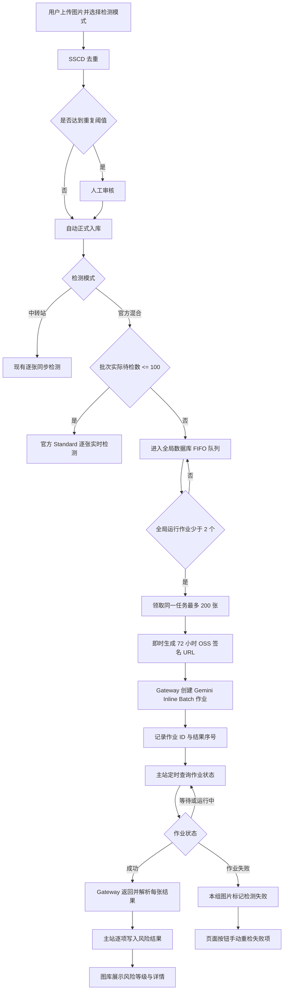

# Gemini 官方混合侵权检测设计

日期：2026-09-15  
状态：已实现并通过本地回归测试，待生产发布验证

## 1. 背景与目标

生产环境使用 Gemini 官方 Flex 同步检测时，即使将并发降为 2 并延长代理超时，仍持续返回 `HTTP 503`。这符合 Flex 的低优先级、尽力而为容量模型，不适合作为当前批量图片检测的可靠生产通道。

本次将上传页可选的“官方 Flex”替换为“官方混合”，保留中转站作为默认模式，并保留原 Flex 代码用于旧批次兼容和紧急回退。官方混合统一使用 `gemini-3.8-flash`、Google Search 和现有结构化 JSON 输出；系统按批次实际待检测图片数自动选择 Standard 或 Batch。

目标：

- 新批次可选择“中转站”或“官方混合”，默认仍为中转站。
- 实际待检测数小于等于 100 张时走官方 Standard 实时接口；大于 100 张时走官方 Batch 异步接口。
- 官方 Batch 按多张图片组成异步作业，避免逐张同步请求的 Flex 容量错误并降低大批量成本。
- Batch 结果写入现有侵权检测记录，页面继续展示风险等级、原因、描述、分类标签、搜索使用情况和完成时间。
- 不增加 Redis，不新增业务表，不自动重新提交失败的模型任务。
- 保留现有中转站与旧 `OFFICIAL_FLEX` 执行能力。

## 2. 已确认取舍

Gemini Batch 的价格约为标准调用的 50%，适合非实时的大批量后台任务。官方目标完成时间为 24 小时以内，多数作业会更快，但系统不承诺 `1000 张/20 分钟`。

Google 官方文档说明 Batch 支持在单个请求配置中使用 Google Search；`gemini-3.8-flash` 同时支持图片输入、Search Grounding、结构化输出和 Batch API：

- https://ai.google.dev/gemini-api/docs/batch-api
- https://ai.google.dev/gemini-api/docs/models/gemini-3.8-flash

系统只轮询 Batch 作业状态。轮询不会再次执行模型，也不产生重复图片检测费用。作业或单项失败后，必须由页面按钮手动发起新的 Batch 检测。

## 3. 整体流程

正式入库与侵权检测继续解耦。图片一旦确认不重复即可在图库看到；侵权检测只补充风险状态，技术失败不会被写成低风险。

## 4. 模式、路由与兼容策略

新增用户模式值 `OFFICIAL_HYBRID`。

- `RELAY`：中转站，同步逐张检测，保持现状并作为上传页默认值。
- `OFFICIAL_HYBRID`：官方混合模式，作为用户可选模式。批次实际待检测图片数 `<= 100` 时走 Standard，`> 100` 时走 Batch。
- `OFFICIAL_FLEX`：不再出现在新建批次选项中；后端和 Gateway 暂时保留，确保历史批次和回退不被破坏。

“实际待检测图片数”按 SSCD 完成后的非重复、非失败图片总数计算，包含自动入库图片及等待人工审核的图片。该值在同一上传批次内固定用于路由，因此同一批次不会一部分走 Standard、一部分走 Batch。人工审核拒绝部分图片不会把已经选定的 Batch 路由改回 Standard。

历史 `OFFICIAL_FLEX` 批次不自动改写为混合模式，避免修改审计记录。测试时新建一个批次并明确选择“官方混合”。

## 5. 最小数据模型

不新增表。只在 `infringement_scan_item` 增加：

| 字段 | 用途 |
| --- | --- |
| `provider_job_id` | Gemini Batch 作业资源名；同一小组图片共享一个值 |
| `provider_request_index` | 图片在该 Batch 作业中的结果序号 |

现有字段继续复用：

- `status`：`PENDING`、`PROCESSING`、`SUCCESS`、`FAILED`。
- `attempt_count`：真正提交模型作业时加 1；状态轮询不增加。
- `last_request_id`：记录主站本次提交 Gateway 的请求 ID。
- `error_code`、`error_message`：保存作业级或单项失败原因。
- `raw_ai_response`、`model`、`prompt_version`、`search_used`、`search_query_count`：保存成功结果和搜索审计。

一个侵权检测任务可能因为总请求大小被拆成多个 Gemini Batch 作业，因此作业 ID 必须放在明细表，不能只放任务表。

## 5.1 与中转站对比

| 维度 | 官方混合 | 中转站 |
| --- | --- | --- |
| 小批次速度 | `<=100` 使用 Standard，通常可较快逐张完成 | 逐张实时，实际速度取决于中转站容量 |
| 大批次成本 | `>100` 使用 Batch，官方价格约为 Standard 的 50% | 以中转站计费规则为准 |
| 大批次时效 | 官方目标 24 小时内，不承诺 20 分钟 | 可能更快，但不受 Google 官方 Batch 时效约束 |
| Google Search | 直接由 Gemini 官方返回 Grounding 记录 | 依赖中转站是否真实透传并返回搜索记录 |
| 稳定性 | Standard 避开 Flex 503；Batch 适合吞吐但异步 | 依赖中转站自身和其上游稳定性 |
| 审计透明度 | 官方作业 ID、模型和搜索元数据可追踪 | 可追踪程度取决于中转站响应 |
| 运维复杂度 | 需要保存 Batch 作业 ID 并轮询 | 当前逐张流程更简单 |

推荐默认仍保留中转站，方便低成本快速处理；对准确性、Google Search 证据和供应商可追踪性要求更高的批次，选择官方混合。

## 6. 全局队列、分组和提交

新增主站 Batch Worker，只处理路由结果为 Batch 的 `OFFICIAL_HYBRID` 待检测项；现有 Worker 处理 `RELAY`、路由结果为 Standard 的 `OFFICIAL_HYBRID`，以及历史 `OFFICIAL_FLEX`。

所有用户的官方 Batch 明细共用 `infringement_scan_item` 持久队列，不增加 Redis 或新业务表。队列按任务创建时间、任务 ID、图片明细 ID 执行 FIFO；主站通过数据库事务锁定最早的一组待处理记录，避免并发上传或多实例调度时重复领取。

全局最多同时存在 2 个正在提交或运行的 Gemini Batch 作业。已有 2 个作业时，新明细保持 `PENDING`；中转站实时和官方 Standard 使用现有实时 Worker，不受 Batch 长任务阻塞。

每个 Gemini Batch 作业同时满足：

- 只包含同一个 `infringement_scan_task` 的图片。
- 最多 200 张；1000 张业务批次通常透明拆为 5 个 provider job，页面仍显示为一个业务批次。
- 图片不以 Base64 或 Multipart 经过主站和 Gateway。主站在真正领取小组后，为每张 OSS 对象即时生成有效期 72 小时的只读 HTTPS 签名 URL。
- Gateway 使用 `BatchJobSource.inlinedRequests`，每个请求通过 `Part.fromUri` 引用一张图片。200 张的固定边界为重复提示词、Schema、URL 和 JSON 包装预留空间，确保 Batch 创建请求低于官方 20 MB 限制。

提交前，主站在一个短事务内锁定并将选中的明细从 `PENDING` 改为 `PROCESSING`，同组共享 `last_request_id`，同时占用一个全局运行槽。网络调用不放在数据库事务内。Gateway 使用 Inline Batch 创建作业，每个请求继续携带现有 Prompt、图片 URL、Google Search、温度 0 和结构化响应 Schema，但不再设置 `serviceTier=FLEX`。

提交成功后，主站写入 `provider_job_id`、`provider_request_index` 和 `last_request_id`。

如果图片读取失败，只将该图片标记为 `FAILED/IMAGE_READ_FAILED`，不影响同组其他图片。如果 Gateway 明确返回提交失败，则本组标记失败。如果请求结果未知，例如网络在提交后断开，则标记 `FAILED/BATCH_SUBMIT_UNKNOWN`，不自动重新提交，以免产生重复计费。

## 7. 状态查询与结果处理

主站每 30 秒查询仍有 `PROCESSING` 项的不同 `provider_job_id`。同一个作业在一次调度中只查询一次。

- `PENDING`、`RUNNING`：保持现状，等待下次查询。
- `SUCCEEDED`：Gateway 按返回顺序解析每张结果，主站用 `provider_request_index` 对应图片并写入成功状态。
- `FAILED`、`CANCELLED`、`EXPIRED`：该作业未产生有效结果的图片全部标记失败，并保存明确的作业状态和错误原因。
- 单项响应错误：只标记对应图片失败，其他图片照常保存。
- 临时查询网络错误：保留 `PROCESSING`，下次继续查询；这只是查询恢复，不是重新调用模型。

服务重启后，Worker 根据数据库里的 `provider_job_id` 恢复查询，不依赖内存或 Redis。

## 8. Gateway 接口

在现有内部 Token 鉴权下保留两个接口：

1. `POST /internal/v1/image-risk/batches`
   - 接收 1 至 200 个只读 HTTPS 图片 URL 及 MIME type。
   - 创建 Gemini Inline Batch。
   - 返回 `providerJobId` 以及每张图片的结果序号。

2. `GET /internal/v1/image-risk/batches?jobId=...`
   - 查询作业状态。
   - 成功时返回按序号排列的解析结果或单项错误。

Gateway 保持无业务数据库和临时文件状态；作业 ID 和图片映射全部由主站保存。不得记录完整签名 URL。

## 9. 页面调整

- 上传页选项从“官方 Flex”改为“官方混合（≤100 张实时，>100 张 Batch）”，默认仍选“中转站”。
- 批次、检测任务列表显示“官方混合”，并在任务上显示实际执行通道“Standard”或“Batch”。
- Batch 已提交但尚未完成时继续显示“检测中/等待 Google 处理”，避免误报系统卡死。
- 现有“重新检测失败项”按钮不变；它只为当前任务失败图片创建一次新的 Batch 任务。
- 历史 `OFFICIAL_FLEX` 仍显示“官方 Flex”。

## 10. 测试与验收

自动化测试至少覆盖：

- 上传请求接受 `OFFICIAL_HYBRID`，拒绝未知模式。
- 100 张实际待检测图片路由到 Standard，101 张路由到 Batch；同一上传批次的后续人工审核任务保持首次确定的执行通道。
- 1000 张同一任务拆成 5 个最多 200 张的 provider job。
- 全局已有 2 个提交中或运行中作业时不再领取，作业终态后才释放槽位。
- 多个任务按创建时间、任务 ID、图片 ID 执行 FIFO，事务领取不会重复。
- Batch 输入使用 OSS 签名 URL，不读取整批图片字节、不创建 JSONL 临时文件。
- Batch 配置包含图片、Google Search、结构化 Schema，且不包含 Flex service tier。
- 提交成功后保存作业 ID、序号和请求 ID。
- 查询等待状态不重提模型、不增加 `attempt_count`。
- 作业成功、作业失败和单项失败均正确落库。
- 服务重启后可继续查询已有作业。
- 中转站和历史 Flex 流程不回归。

线上验收使用新建的小批次：

1. 选择“官方混合”上传 5 至 10 张图片，确认走 Standard 且只调用一次。
2. 确认图片先进入正式图库，风险状态显示等待检测。
3. 再使用 101 张以上的非重复图片新建批次，确认只创建 Batch 作业，没有逐张同步 Gemini 调用。
4. 等待完成，核对风险结果、Google Search 使用情况和完成时间。
5. 人为制造一条失败项，确认只有页面按钮会再次提交检测。

## 11. 发布边界

本次只修改代码和提供验证结果。按照用户约定，打包、上传和发布均由用户执行，Codex 提供完整命令和核验步骤，不直接操作生产服务器。

不在本次范围内：

- 不删除 Flex 客户端。
- 不自动从 Batch 回退到标准、Flex 或中转站。
- 不自动重试失败的模型作业。
- 不承诺 Batch 的 20 分钟完成时效。
- 不增加 Redis、消息队列或新业务表。
